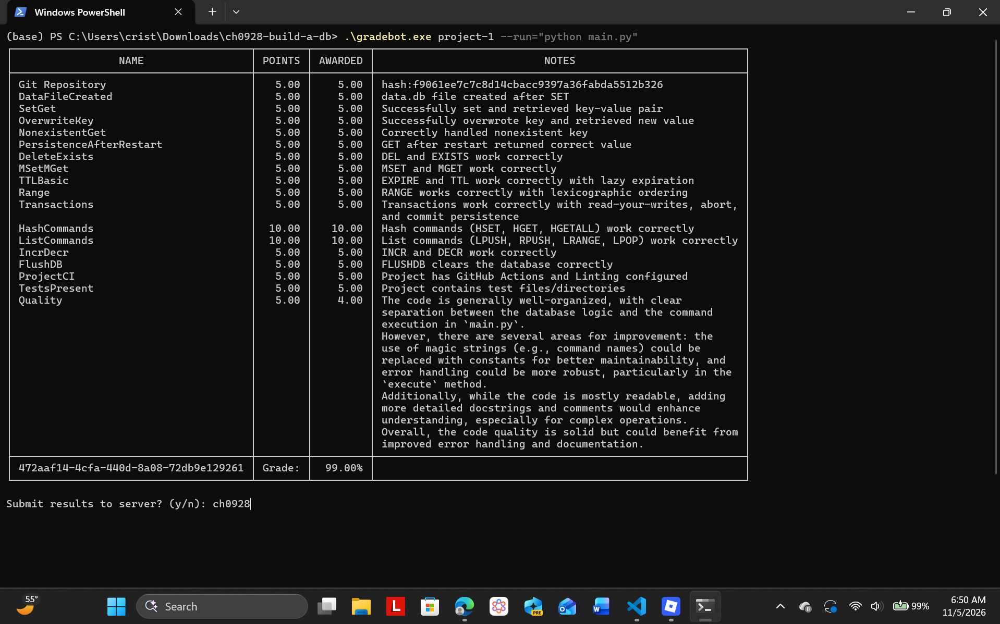

# ch0928-build-a-db

## Cristian Hernandez

The database supports commands such as SET, GET, DEL, MSET, MGET, transactions, expiration, hashes, lists, and counters.

## Run

```bash
python main.py
```

## Test

```bash
python -m unittest discover -v
```

## Gradebot

```bash
./gradebot.exe project-1 --run="python main.py"
```

Automated testing and linting are configured using GitHub Actions and Ruff.

## Gradebot Screenshot


